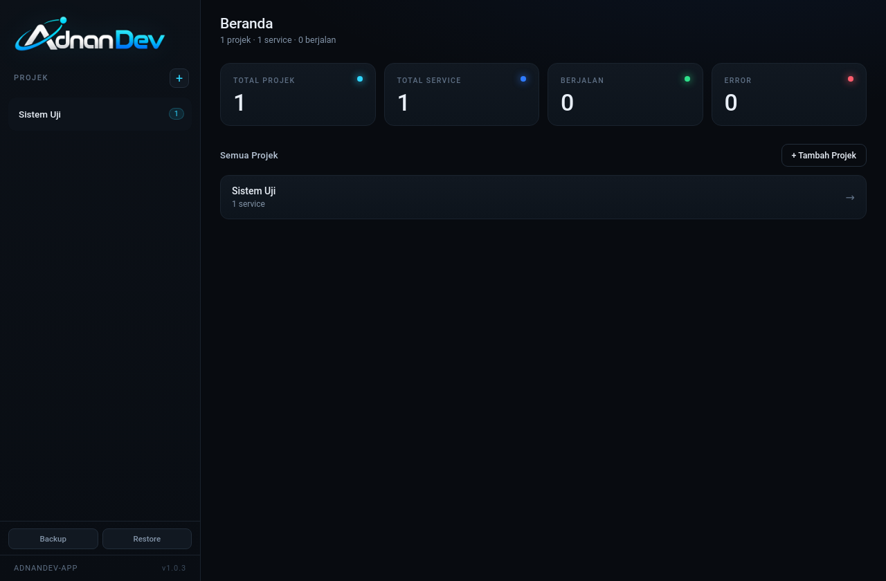
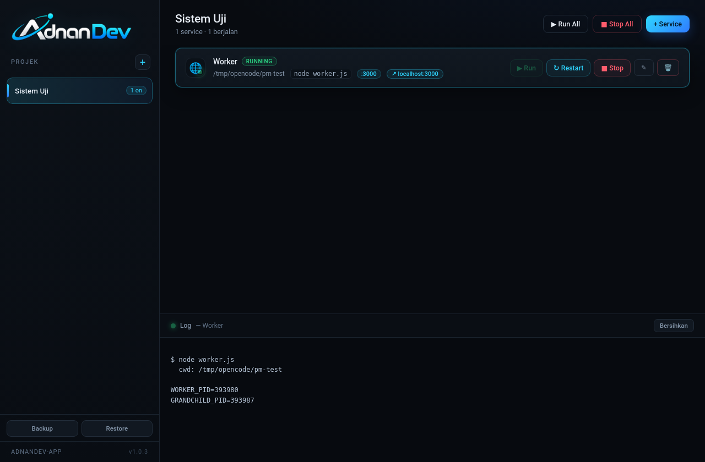
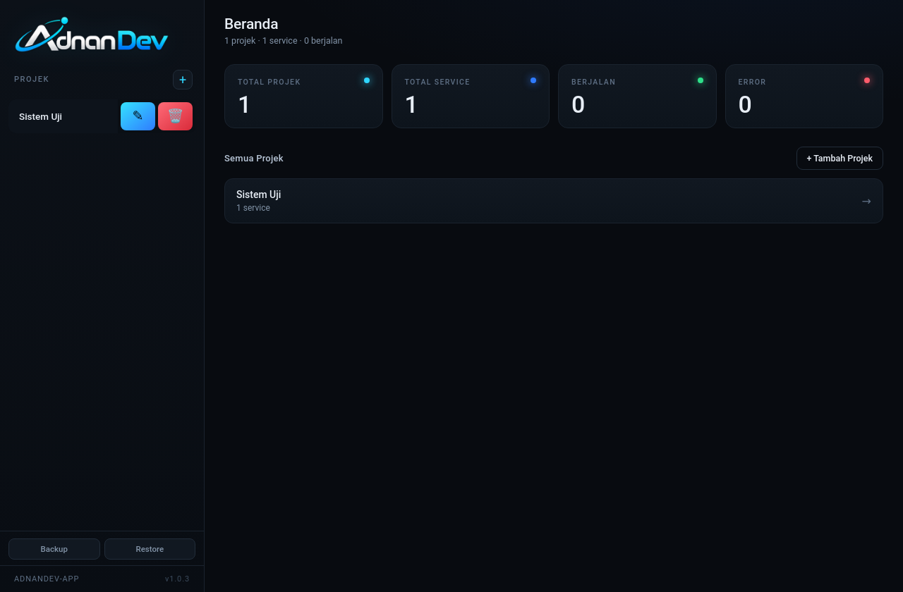

# ADNANDEV-APP

Aplikasi desktop Linux untuk mengelola dan menjalankan semua service projek
kamu dari satu layar. Tidak perlu lagi buka banyak tab terminal dan mengetik
`npm run dev` satu per satu.







## Fitur

- **Halaman Beranda** — klik logo AdnanDev untuk kembali ke Beranda. Menampilkan
  total projek, total service, jumlah service berjalan, dan jumlah error.
- **Ikon per service** — pilih ikon (globe, server, database, API, docker, dll)
  lewat grid di form service. Ikon tampil di kartu dengan badge status kecil.
- **Restart per service** — satu klik untuk stop lalu run ulang otomatis,
  tanpa perlu klik Stop kemudian Run manual.
- **Aksi projek ala Android** — tombol **Edit** dan **Hapus** tidak selalu tampil.
  Geser item projek ke kiri (swipe) untuk memunculkan dua kotak aksi besar.
- **Link service bisa diklik** — setiap service bisa punya link (mis. `http://localhost:3000`)
  yang langsung terbuka di browser default saat diklik.
- Kelola banyak **Projek**, masing-masing berisi banyak **Service**
  (Frontend, Backend, API, Storage, dll).
- Tiap service punya **folder**, **command**, dan **port** sendiri.
- Klik **Run** / **Stop** per service.
- **Run All** / **Stop All** untuk seluruh service dalam satu projek.
- Status realtime: `Running` / `Stopped` / `Error`.
- **Log realtime** per service (stdout + stderr), tanpa tercampur.
- Stop mematikan **seluruh process tree** — tidak ada proses `npm`/`node`
  yang tertinggal.
- Konfigurasi tersimpan otomatis ke file JSON.
- Semua service berhenti otomatis saat aplikasi ditutup.

## Menjalankan (mode development)

Butuh Node.js 18+.

```bash
npm install
npm start
```

## Build AppImage (aplikasi siap pakai)

```bash
npm run build:appimage
```

Setiap kali build, **versi patch otomatis naik**:

```
1.0.0 → 1.0.1 → 1.0.2 → ...
```

Hasilnya:

```
dist/ADNANDEV-APP-1.0.1.AppImage
```

Jadikan executable lalu jalankan:

```bash
chmod +x dist/ADNANDEV-APP-1.0.1.AppImage
./dist/ADNANDEV-APP-1.0.1.AppImage
```

> Di beberapa distro, AppImage butuh FUSE. Kalau tidak tersedia, jalankan
> dengan `--appimage-extract-and-run`.

### Mengatur versi major/minor

Versi patch diurus otomatis. Kalau ingin menaikkan angka depan (major/minor),
ubah `version` di `package.json`, contoh dari `1.0.1` menjadi `1.2.0`.

Build berikutnya akan memakai `1.2.0` apa adanya, lalu build-build setelahnya
otomatis menjadi `1.2.1`, `1.2.2`, dst. Versi build terakhir dicatat di
`.last-build-version`, dan versi yang sedang berjalan tampil di sidebar aplikasi.

## Cara pakai

1. Buka aplikasi — kamu akan melihat **Beranda** berisi ringkasan semua projek.
2. Klik **+ Tambah Projek**, isi nama (contoh: `Sistem Gudang`).
3. Buka projek (klik dari daftar di Beranda atau sidebar), klik **+ Service**.
4. Isi:
   - **Nama** → `Frontend`
   - **Ikon** → pilih dari grid (opsional)
   - **Folder** → path folder service (bisa lewat tombol **Pilih…**)
   - **Command** → `npm run dev`, `npm run start:dev`, dll
   - **Port** → opsional, contoh `3000`
   - **Link** → opsional, contoh `http://localhost:3000` (bisa diklik di kartu service)
5. Ulangi untuk `Backend`, `API`, `Storage`, dst.
6. Klik **▶ Run** untuk menjalankan, **↻ Restart** untuk restart, **■ Stop** untuk menghentikan.
7. Klik service untuk melihat log-nya di panel bawah.
8. Klik **logo** kapan saja untuk kembali ke Beranda.

## Lokasi konfigurasi & backup

Konfigurasi utama:

```
~/.config/ADNANDEV-APP/config.json
```

Backup otomatis (dibuat setiap ada perubahan, maksimal 20 file terakhir):

```
~/.config/ADNANDEV-APP/backups/config-<tanggal>-<jam>.json
```

Selain itu ada tombol **Backup** dan **Restore** di sidebar untuk menyimpan /
memulihkan konfigurasi secara manual ke file JSON pilihanmu.

## Catatan teknis

- Command dijalankan lewat shell di folder service (`/bin/sh -c "<command>"`).
- Proses dijalankan sebagai process group sendiri, sehingga **Stop** bisa
  mematikan parent + child process sekaligus.
- Status & PID bersifat runtime (tidak disimpan permanen).
- Port hanya label/info; pengecekan konflik port belum termasuk.

## Struktur projek

```
electron/
  main.cjs            # main process, IPC, window
  preload.cjs         # bridge aman ke renderer
  store.cjs           # penyimpanan JSON projek & service
  process-manager.cjs # spawn, kill process tree, log, status
src/
  index.html
  styles.css
  app.js              # UI + interaksi
assets/
  logo-original.png   # wordmark AdnanDev (dari logo asli)
  icon.png            # ikon aplikasi (huruf A dari logo)
logo-line.webp        # file logo sumber
PRD.md
```
